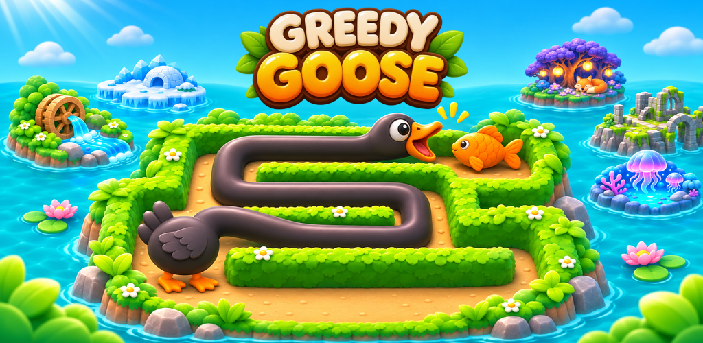
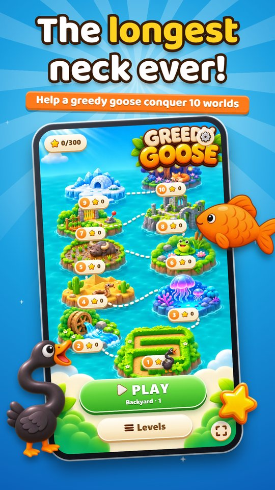
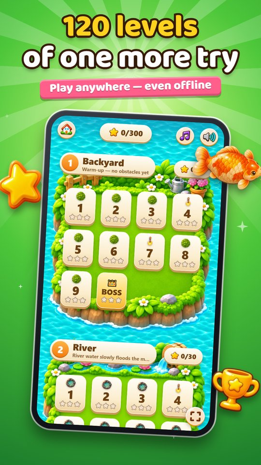
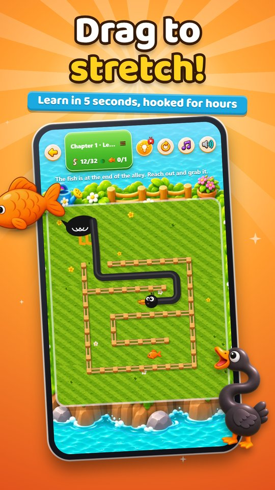
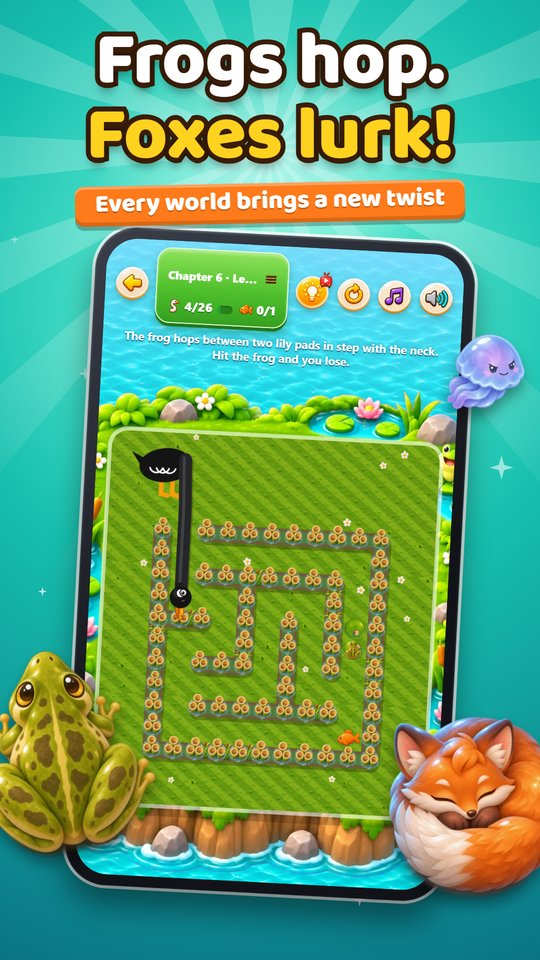
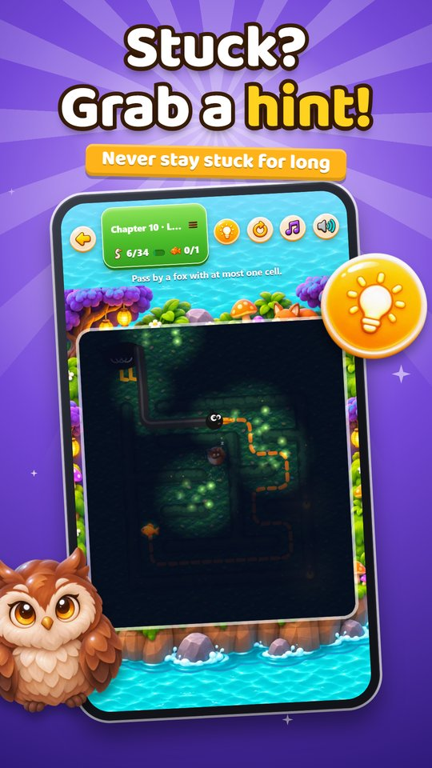
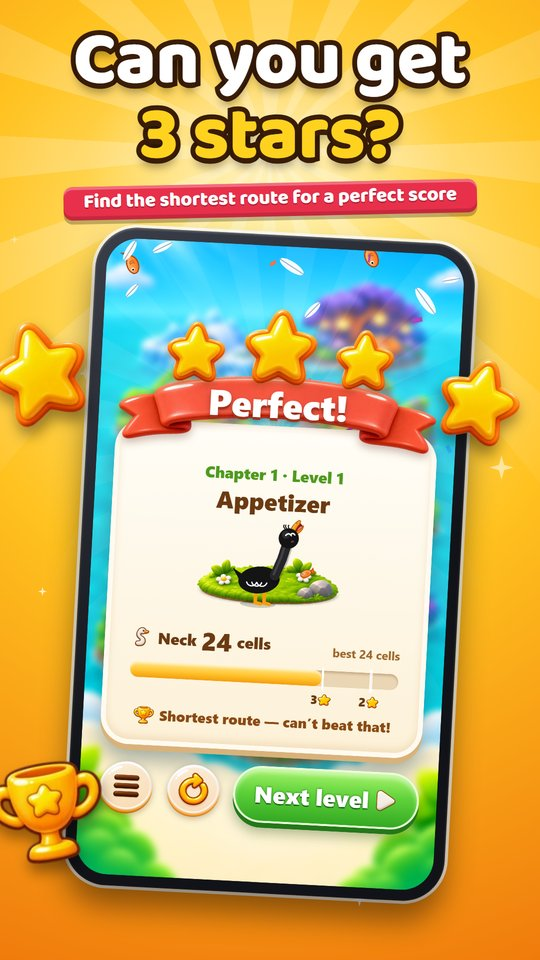
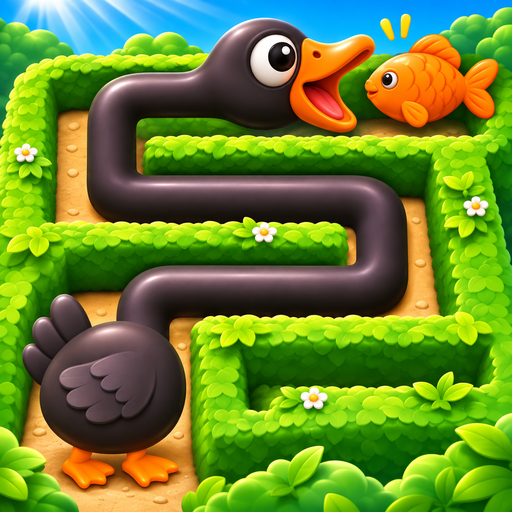

  

<h1 align="center">🪿 Greedy Goose: Snake Puzzle</h1>

  <b>Eat every fish. Just don't tie your neck in a knot!</b> 
  A snake-style maze puzzle with a hungry goose · 120 hand-crafted levels · fully offline

  <a href="https://play.google.com/store/apps/details?id=com.classbk.goose"><b>▶ Get it on Google Play</b></a>
  &nbsp;·&nbsp;
  <a href="https://luckybk93.github.io/greedy-goose-privacy/">Privacy Policy</a>
  &nbsp;·&nbsp;
  <a href="#-tiếng-việt">Tiếng Việt</a>

---

## 🎮 How to play

Drag the goose's head through the maze and watch its neck stretch behind it. Gobble all the fish and reach the exit, but think ahead: **your own long neck becomes the wall you have to get around!**

Learn it in 5 seconds. Try to master it for weeks.

  
  
  

## 🌍 10 worlds, 10 new twists

| World | Twist |
|---|---|
| 🏡 Backyard | Learn the long-neck basics |
| 🌊 River | The water is rising, grab the fish before your goose gets soaked |
| 🐚 Sea | Wait for the tide, watch out for drifting jellyfish |
| 🏜️ Desert | Sand pours into the maze while snakes guard the way |
| 🌾 Rice paddy | Muddy tiles cost double neck length |
| 🪷 Lotus pond | Frogs hop between lily pads and bite careless necks |
| 🌻 Garden | Press switches with your neck to open the gates |
| 🏰 Castle | Swallow a big fish and you won't fit through narrow gaps |
| ❄️ Frozen lake | Step on the ice and slide until something stops you |
| 🌙 Night forest | Tiptoe past sleeping foxes… don't wake them up! |

  
  
  

## ⭐ Why players love it

- 👆 **One-finger controls**: just drag, pull back anytime
- ☕ **Short levels**, perfect for a coffee break or the bus ride
- 🏆 Find the **shortest route** to earn a perfect 3 stars
- 🔥 Tricky **HARD** levels and a **BOSS** level in every world
- 💡 Stuck? A **hint** shows you a safe path
- ✈️ **Play offline**: every level works without internet
- 🎨 Glossy 3D cartoon art and relaxing music
- 🌐 Available in **14 languages**

Fans of snake puzzles, logic puzzles, maze games and brain teasers will feel right at home.

**How far can your goose stretch?** 👉 [Download on Google Play](https://play.google.com/store/apps/details?id=com.classbk.goose)

---

## 🇻🇳 Tiếng Việt

### Ngỗng Tham Ăn: Mê Cung Giải Đố

**Ăn hết cá, nhưng đừng để cổ tự thắt nút!** Game giải đố kiểu rắn săn mồi với chú ngỗng háu ăn, 120 màn chơi, chơi offline.

Kéo đầu ngỗng đi qua mê cung, mỗi bước cổ lại dài thêm. Ăn hết cá rồi về đích, nhưng phải tính trước: chính chiếc cổ dài của bạn sẽ thành bức tường chắn đường! Hiểu luật trong 5 giây, càng chơi càng nghiện.

- 🌍 **10 vùng đất, 120 màn**: sân vườn, dòng sông, biển cả, sa mạc, ruộng lúa, ao sen, vườn rau, lâu đài, hồ băng, rừng đêm, mỗi nơi một luật chơi mới
- 👆 Điều khiển một ngón tay: kéo để đi, kéo lùi để rút cổ
- 🏆 Tìm đường ngắn nhất để đạt trọn 3 sao, màn KHÓ và màn BOSS cuối mỗi vùng
- 💡 Bí quá? Gợi ý chỉ ngay đường đi an toàn
- ✈️ Chơi offline, không cần mạng · hỗ trợ 14 ngôn ngữ, có tiếng Việt

👉 [Tải trên Google Play](https://play.google.com/store/apps/details?id=com.classbk.goose)

---

   
  © 2026 Greedy Goose · <a href="https://luckybk93.github.io/greedy-goose-privacy/">Privacy Policy / Chính sách quyền riêng tư</a>

